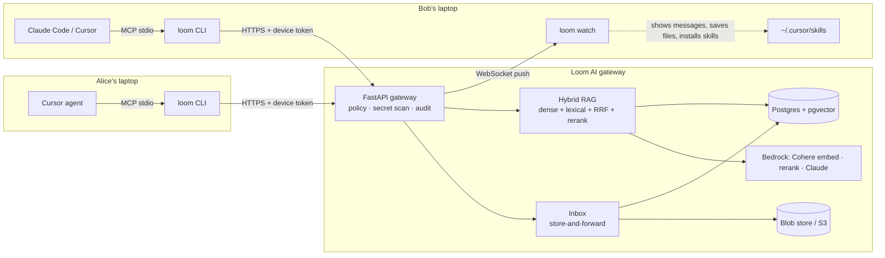

# Loom AI

**One brain for the whole team's AI agents.** Every teammate keeps using their own agent (Cursor,
Claude Code, the Claude app). Those agents connect to **Loom AI**, the team's shared brain. Its **Conductor AI**
(Claude on Amazon Bedrock) answers questions about the team's projects from their code, docs and notes, citing every
source, and writes each project's brief. Agents also send files, skills and messages to each other through Loom AI. It
decides what each agent may see and send, blocks secrets, and records everything in one audit log.

**There is nothing to host.** Loom AI runs for you on AWS. You paste one line into a terminal and keep talking to
your agent the way you already do.

## Start in one minute

You need macOS or Linux and at least one of Cursor, Claude Code or the Claude desktop app. You don't need AWS, Docker
or a Python setup: the installer brings everything it needs.

### 1. Start your team

Open a terminal and paste:

```bash
curl -fsSL https://raw.githubusercontent.com/versean/LoomAI/main/install.sh | sh
```

It asks three questions (team name, your name, your email), then:
- installs the `loom` command
- creates your team on Loom AI, with you as its admin
- connects every AI app it finds: Cursor (with the secret-blocking prompt guard), Claude Code and the Claude app
- opens a `loom watch` window where teammates' messages and files show up live

**Restart your AI app** (for the Claude app, quit it fully) and ask it: **"Loom, who am I?"**

### 2. Give Loom your project

In your project's folder:

```bash
loom project create "My App"
loom ingest .                        # or straight from GitHub: loom github owner/repo
```

`ingest` respects `.gitignore` and never uploads `.env` files, keys or anything that looks like a secret; those are
stopped on your computer. Run it again whenever the code changes a lot.

### 3. Invite your teammates

```bash
loom invite -p my-app
```

This prints **one team link**. Paste it into your team chat. Each teammate pastes it into a terminal:

```bash
curl -fsSL https://raw.githubusercontent.com/versean/LoomAI/main/install.sh | sh -s -- inv_…
```

It asks for their name and email, then puts them in your team and in `my-app` with their AI apps connected. The email
is only their identity in the team; nothing is ever emailed.

The link lets in up to 20 people (`--uses 50` for more) and expires after 7 days. Treat it like a password for
your team chat: anyone who has it can join. You see everyone who joined in `loom status`, the dashboard and the audit
log, `loom revoke` cuts off a computer, and `loom cancel-invite inv_…` stops the link early.

For one specific person, `loom invite sri@example.com --name Sri -p my-app` makes a personal invite that works once.
Personal invites can also make someone a project owner (`--role owner`); team links can't.

### 4. Just talk to your agent

There are no commands to learn. Once connected, your agent sees Loom AI's tools and calls them by itself:

| Say to your agent | What happens |
| --- | --- |
| "Loom, who am I?" | Your team, projects and inbox |
| "How does deploy work in this project?" | An answer from the team's code and docs, citing `file:lines` |
| "What did we decide about the database?" | Finds the decision in docs and saved notes |
| "Send the release checklist skill to Sri" | Secret check, then it installs itself into Sri's Cursor and Claude Code |
| "Send Sri a message: the header needs fixing" | It pops up in Sri's `loom watch` window with a notification |
| "Send this file to Sri" | Saved to Sri's `~/Loom/inbox/<you>/` |
| "Did anyone send me anything?" | Your inbox |
| "Remember for the team: we freeze code on Wednesdays" | A note every teammate's agent can find right away |

If you ask about something that isn't in the project, Loom says *"Not in project knowledge."* instead of guessing.

## Everyday commands

You rarely need these, but they're there:

| Command | Does |
| --- | --- |
| `loom status` | Who you are, your projects, your inbox, which agents are connected |
| `loom watch` | Live window for messages, files and skills (the installer opens it for you) |
| `loom dashboard` | Opens the team dashboard in your browser |
| `loom ask "…"` | Ask from the terminal instead of through an agent |
| `loom send Sri ./notes.md` | Send a file, a skill (`SKILL.md`) or `--message "…"` |
| `loom project create "Name"` | A new project; you become its owner |
| `loom project add-member my-app sri@example.com` | Give someone already in the team access to a project |
| `loom invite -p my-app` | One team link for your chat (or `loom invite sri@example.com -n Sri` for one person) |
| `loom cancel-invite inv_…` | Stop an invite or team link from working |
| `loom devices` / `loom revoke <id>` | See connected computers and cut one off instantly |
| `loom audit -f` | Live log of every agent action (admins) |

To update, paste the install line again (without an invite code): it updates `loom` and reconnects your apps.

### If something doesn't work

- **`loom: command not found`**: open a new terminal, or use the full path the installer printed.
- **The agent doesn't know about Loom**: restart the app completely, then run `loom connect all` and restart again.
- **"Invite expired or already used"**: ask for a new one. Invites last 7 days; a personal invite works once and a
  team link until it's full.
- **"…is already in this team"**: that email already joined, so a team link can't add it again. To add another
  computer for the same person, the admin sends a personal invite.
- **Windows**: use WSL, or install [uv](https://docs.astral.sh/uv/) and run
  `uv tool install "git+https://github.com/versean/LoomAI#subdirectory=packages/cli"`, then
  `loom init` (or `loom join <code>`) and `loom connect all`.

## What it does



| Agent asks… | Loom AI… |
| --- | --- |
| "How do we deploy?" | answers from the project's code, docs and notes, citing `path:lines`, and only from projects the user belongs to |
| "What's the capital of France?" | refuses with *"Not in project knowledge."* (a relevance threshold, so it never guesses) |
| "Send my deploy skill to Bob" | checks both are project members, scans for secrets, puts it in Bob's inbox; Bob's `loom watch` installs it into Cursor *and* Claude Code |
| "Send Bob a message: lunch at noon?" | it appears in Bob's `loom watch` window right away, with a desktop notification |
| "Send `.env` to Bob" | blocks it on the laptop: it never leaves the computer, and the attempt is audited |
| "Remember: we chose pgvector" | saves a note every teammate's agent can find immediately |

Controls for the Agent Harness track:
- **Identity**: one revocable token per device, and the agent's name (Cursor, Claude) is recorded per call.
- **Policy**: owner, member and viewer roles per project. The permission join sits inside the retrieval SQL, so another project's chunks are never even scored.
- **Isolation**: every team on the hosted server is a separate team. Projects, people, deliveries, the audit log and the dashboard are all scoped to it; another team can't search, see or message yours.
- **Secret scanning**: runs on the laptop before upload or send, again on the server, and optionally through a Bedrock Guardrail.
- **Prompt guard**: a Cursor `beforeSubmitPrompt` hook blocks prompts containing secrets before they reach any model.
- **Audit**: every allow, deny and error with latency, streamed live to admins (`loom audit -f`).

The RAG pipeline follows the practices evaluated in our thesis:
- Hybrid dense plus lexical search with Reciprocal Rank Fusion (k=60, weights 0.7/0.3).
- A pool of 20 candidates, cross-encoder reranked to the top 5.
- A refusal threshold checked before calling the LLM.
- Follow-up question rewriting.
- A grounded prompt with numbered sources and prompt-injection rules.
- Structure-aware chunks that carry their file, heading and line range.

## Projects and roles

Access is per project: an agent only sees projects its user belongs to.

- **Anyone in the team can create a project** with `loom project create`, and becomes its owner.
- **Add an existing teammate** without a new invite:
  `loom project add-member my-app sri@example.com --role member`. Remove them with `loom project remove-member`.
- **Questions don't need a project name.** Loom searches every project you belong to; `--project` narrows it down.
- **Deliveries happen inside a project** that both people belong to.
- **The email in an invite is the person's identity**, so use a different email per person.

| Role | Can |
| --- | --- |
| Team admin | Invite people to the team, see the whole audit log, revoke any computer |
| Owner | Invite people to the project, manage its members, add knowledge |
| Member | Ask, add knowledge and notes, send to teammates |
| Viewer | Ask only |

## Dashboard

```bash
loom dashboard
```

This opens **the team dashboard** in your browser with a one-time login link that expires after two minutes, so the CLI's token never reaches the browser.

- **Figures:** questions answered, deliveries, actions stopped and active agents over the last 24 hours.
- **Team tree:** Loom AI at the root, then each member, their computers, and the agents seen on each computer. Admins can revoke a computer from here.
- **Ledger:** a live, filterable record of every agent action, with blocked actions shown in red and the reason for each block.
- **Projects and house rules:** what each project holds, and the policies enforced on every call.

## Running your own server (optional)

The hosted Loom AI is the easy path. Run your own when the code must stay in your own cloud account, or to develop
Loom AI itself. Point the CLI at it with `--server` (or `LOOM_SERVER=… ` before the install line); invite lines
from your server then include its address automatically.

- **Your own AWS account.** One command builds the whole stack: CloudFront (HTTPS, no domain needed), an ALB, EC2 in a
  private subnet, RDS PostgreSQL, S3 and Bedrock. It takes about 15 minutes the first time and 2 minutes for updates.
  ```bash
  bash deploy/aws/deploy.sh                    # needs AWS credentials with Bedrock enabled, in us-east-1
  OPEN_SIGNUP=true bash deploy/aws/deploy.sh   # let anyone start a team without the secret (how ours runs)
  ```
  It prints the `loom init --server … --secret …` command that creates the first team. Details:
  [`deploy/README.md`](deploy/README.md), background and the IAM policy in [`docs/AWS.md`](docs/AWS.md), and the
  architecture diagram in [`docs/loom-ai-aws-architecture.drawio`](docs/loom-ai-aws-architecture.drawio).

- **Your laptop.** Needs Docker and [uv](https://docs.astral.sh/uv/). Only this computer can reach it.
  ```bash
  docker compose up -d                 # Postgres 17 + pgvector on :5433
  uv sync
  uv run loom-server                  # gateway on http://127.0.0.1:8787 (keep running)
  uv run loom init --server http://127.0.0.1:8787
  ```

### Models

A self-hosted server runs everything locally by default:
- hashed n-gram embeddings
- a lexical reranker
- an extractive answer that quotes the top passages, or Ollama if you set `LOOM_LLM_PROVIDER=ollama`

The hosted server and the AWS deploy use Bedrock. To switch a laptop server to Bedrock, set in `.env`
(see `.env.example`):

```bash
LOOM_EMBEDDING_PROVIDER=bedrock     # Cohere Embed Multilingual v3 (1024-d)
LOOM_RERANK_PROVIDER=bedrock        # Cohere Rerank 3.5 via Bedrock Rerank
LOOM_LLM_PROVIDER=bedrock           # Claude via Converse
LOOM_S3_BUCKET=…                    # artifacts and raw files in S3 (SSE-KMS)
LOOM_GUARDRAIL_ID=…                 # optional Bedrock Guardrail on everything shared
LOOM_OPEN_SIGNUP=true               # optional: anyone may start a team without the bootstrap secret
```

Changing the embedding model requires re-ingesting, because vectors from different models are not comparable.

## Development

```bash
uv run pytest                        # unit tests + full API flow on a throwaway database
uv run ruff check packages scripts
uv run python scripts/mcp_smoke.py   # talk to `loom mcp` exactly like Cursor does
docker compose down -v               # wipe all data
```

| Package | Contents |
| --- | --- |
| `packages/server` | FastAPI gateway: auth, policy, audit, ingestion and chunking, hybrid retrieval, delivery, WebSocket events, providers |
| `packages/cli` | `loom` CLI: onboarding, ingestion, inbox, `watch`, `connect`, the local MCP server and Cursor hooks |
| `packages/common` | Secret scanner and ignore rules shared by the laptop and the server |
